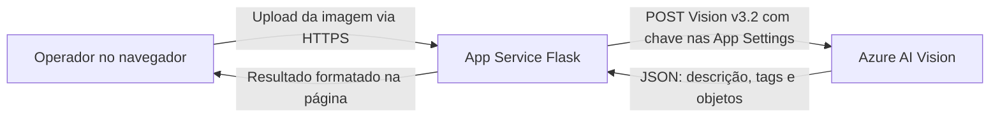

# DroneVision (RM 95866)

Aplicação Web para análise de imagens de monitoramento aéreo, hospedada no **Azure App Service** e integrada ao **Azure AI Vision** (Computer Vision, Image Analysis v3.2).

Repositório: [https://github.com/Guido-AlvaroPC/dronevision-rm95866](https://github.com/Guido-AlvaroPC/dronevision-rm95866)

URL pública após o deploy:

```text
https://app-dronevision-rm95866.azurewebsites.net
```

## Arquitetura (fluxo)



1. O operador abre a aplicação no navegador e envia uma fotografia (HTTPS).
2. O backend no App Service recebe a imagem, valida o arquivo e chama o Azure AI Vision.
3. O Vision devolve JSON com descrição, etiquetas e objetos.
4. O App Service mostra o resultado na página. A chave do Vision **não** vai para o navegador.

## Nomenclatura dos recursos

| Recurso | Nome |
|---|---|
| Resource Group | `rg-dronevision-rm95866` |
| Azure AI Vision | `aiv-dronevision-rm95866` |
| App Service Plan | `plan-dronevision-rm95866` |
| Web App | `app-dronevision-rm95866` |

O Resource Group e o Azure AI Vision ficam em `eastus`. O Vision usa SKU `S1` e `--custom-domain aiv-dronevision-rm95866`, gerando o endpoint:

```text
https://aiv-dronevision-rm95866.cognitiveservices.azure.com/
```

O App Service Plan tenta primeiro `B1` em `eastus`. Se a cota da assinatura estiver zerada, o script **não muda o nome dos recursos** e tenta, nesta ordem:

1. `B1` em `eastus`
2. `B1` em `westus2`
3. `F1` em `westus2`

## Passo a passo no Azure Cloud Shell (Bash)

No [portal do Azure](https://portal.azure.com), abra o Cloud Shell e escolha **Bash**.

```bash
cd ~
git clone https://github.com/Guido-AlvaroPC/dronevision-rm95866.git
cd dronevision-rm95866
chmod +x implantar-rm95866.sh
./implantar-rm95866.sh
```

Se a pasta já existir na sessão:

```bash
cd ~/dronevision-rm95866
git fetch
git reset --hard origin/main
chmod +x implantar-rm95866.sh
./implantar-rm95866.sh
```

Se aparecer `Permission denied`:

```bash
bash implantar-rm95866.sh
```

O script é idempotente: Resource Group e Azure AI Vision já criados são reutilizados. Ele clona o GitHub, empacota a pasta `app/` e publica com `az webapp deploy`. Ao final testa `GET /health`.

`GET /health` deve responder:

```json
{"status":"ok"}
```

## Como a aplicação se integra com a Visão Computacional

O front-end envia a imagem ao backend Flask no App Service via HTTPS, no endpoint `/api/analisar`. O backend lê `VISION_ENDPOINT` e `VISION_KEY` das App Settings do Web App; a chave não é exposta ao navegador.

Com essas variáveis, o Flask chama a API REST do Azure AI Vision (Image Analysis v3.2, `visualFeatures=Description,Tags,Objects`), enviando os bytes da imagem (`Content-Type: application/octet-stream`). O JSON retornado é transformado em descrição, confiança, etiquetas e objetos, que a página exibe. Falhas (arquivo inválido, timeout, autenticação, limite 429, serviço indisponível ou configuração ausente) são convertidas em mensagens amigáveis em português.
