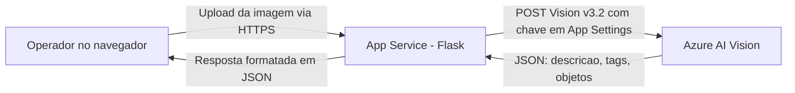

# DroneVision (RM 95866)

Aplicacao Web para analise de imagens de monitoramento aereo com **Azure App Service** + **Azure AI Vision (Computer Vision v3.2)**.

> Entrega oficial da disciplina: deploy em nuvem (Azure).  
> Rodar em localhost e opcional apenas para desenvolvimento rapido.

## Arquitetura (fluxo)



## Nomenclatura dos recursos (padrao obrigatorio)

| Recurso | Nome |
|---|---|
| Resource Group | `rg-dronevision-rm95866` |
| Azure AI Vision | `aiv-dronevision-rm95866` |
| App Service Plan | `plan-dronevision-rm95866` |
| Web App | `app-dronevision-rm95866` |

## Como executar no Azure Cloud Shell (Bash)

```bash
git clone https://github.com/SEU_USUARIO/SEU_REPO.git
cd SEU_REPO
chmod +x implantar-rm95866.sh
./implantar-rm95866.sh
```

### Ajuste manual obrigatorio antes do script

No arquivo `implantar-rm95866.sh`, configure:

- `REPO_URL="https://github.com/SEU_USUARIO/SEU_REPO.git"`

## Como a aplicacao se integra com a Visao Computacional

O front-end envia a imagem para o endpoint `/api/analisar` da aplicacao Flask hospedada no Azure App Service. Esse endpoint valida tipo e tamanho do arquivo (limite de 4 MB) e bloqueia entradas invalidas antes da chamada externa.

No backend, as variaveis `VISION_ENDPOINT` e `VISION_KEY` sao lidas das App Settings do Web App, sem exposicao da chave no navegador. Em seguida, o Flask chama a API REST **Image Analysis v3.2** do Azure AI Vision (`Description, Tags, Objects`), envia os bytes da imagem e recebe o JSON com deteccoes. O backend transforma esse JSON em uma resposta amigavel (descricao, confianca, etiquetas e objetos) e trata falhas com mensagens adequadas para indisponibilidade, autenticacao, limite de requisicoes e imagens invalidas.

## Fontes de imagens para teste (2 imagens minimas)

Use imagens livres relacionadas a drone/monitoramento aereo:

- [Unsplash - aerial city](https://unsplash.com/s/photos/aerial-city)
- [Unsplash - drone forest](https://unsplash.com/s/photos/drone-forest)
- [Pexels - aerial road](https://www.pexels.com/search/aerial%20road/)
- [Pexels - flooded area](https://www.pexels.com/search/flood%20aerial/)

Sugestao de nomes para organizar evidencias:

- `cidade-aerea-01.jpg`
- `estrada-rural-02.jpg`

## Skill de design instalada para UI mais profissional

Para apoiar a construcao da interface interativa, foi utilizada a instalacao da skill do repositorio:

```bash
npx skills@latest add emilkowalski/skills
```

Isso adiciona skills de design/animacao em `.agents/skills/`, usadas como referencia de microinteracoes, contraste e comportamento responsivo.

## Endpoint de saude

- `GET /health` retorna:

```json
{"status":"ok"}
```

## Limpeza dos recursos

```bash
az group delete --name rg-dronevision-rm95866 --yes --no-wait
```

## Checklist de entregaveis/evidencias

- [ ] `implantar-rm95866.sh` no GitHub
- [ ] Codigo da aplicacao Web no GitHub
- [ ] Prints da execucao do script no Azure Cloud Shell
- [ ] Prints dos 4 recursos no Portal Azure (RG, AI Vision, App Service Plan, Web App)
- [ ] Print da aplicacao publicada (`azurewebsites.net`) com imagem analisada e resultado
- [ ] Analise de pelo menos 2 imagens do tema da GS
- [ ] Breve explicacao da integracao com Visao Computacional (secao acima)

## Desenvolvimento local (opcional)

> Somente para desenvolvimento. A entrega valida continua sendo o deploy no Azure.

```bash
python -m venv .venv
source .venv/bin/activate
pip install -r app/requirements.txt
python app/app.py
```
