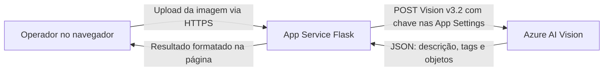

# DroneVision (RM 95866)

Aplicação Web para análise de imagens de monitoramento aéreo, hospedada no **Azure App Service** e integrada ao **Azure AI Vision** (Computer Vision, Image Analysis v3.2).

A entrega oficial é o deploy na nuvem. Execução em localhost, se existir, serve apenas para desenvolvimento e **não vale como entrega**.

Repositório: [https://github.com/Guido-AlvaroPC/dronevision-rm95866](https://github.com/Guido-AlvaroPC/dronevision-rm95866)

URL pública esperada após o deploy:

```text
https://app-dronevision-rm95866.azurewebsites.net
```

## Arquitetura (fluxo)



1. O operador abre a aplicação no navegador e envia uma fotografia (HTTPS).
2. O backend no App Service recebe a imagem, valida o arquivo e chama o Azure AI Vision.
3. O Vision devolve JSON com descrição, etiquetas e objetos.
4. O App Service mostra o resultado na página. A chave do Vision **não** vai para o navegador.

## Nomenclatura dos recursos (padrão obrigatório)

| Recurso | Nome |
|---|---|
| Resource Group | `rg-dronevision-rm95866` |
| Azure AI Vision | `aiv-dronevision-rm95866` |
| App Service Plan | `plan-dronevision-rm95866` |
| Web App | `app-dronevision-rm95866` |

O Resource Group e o Azure AI Vision ficam em `eastus` (região sugerida no enunciado). O Vision usa SKU `S1` e `--custom-domain aiv-dronevision-rm95866`, gerando o endpoint:

```text
https://aiv-dronevision-rm95866.cognitiveservices.azure.com/
```

O App Service Plan tenta primeiro `B1` em `eastus`. Em assinatura acadêmica da FIAP essa cota costuma vir zerada (`Current Limit (B1 App Service instances): 0`). Nesse caso o script **não muda o nome dos recursos** e tenta, nesta ordem:

1. `B1` em `eastus`
2. `B1` em `westus2`
3. `F1` em `westus2`

Isso mantém a nomenclatura exigida e permite concluir o deploy quando a cota de `B1/eastus` não existe.

## Passo a passo no Azure Cloud Shell (Bash)

No [portal do Azure](https://portal.azure.com), abra o Cloud Shell e escolha **Bash**.

### Primeira execução

```bash
cd ~
git clone https://github.com/Guido-AlvaroPC/dronevision-rm95866.git
cd dronevision-rm95866
chmod +x implantar-rm95866.sh
./implantar-rm95866.sh
```

### Se a pasta já existir no Cloud Shell

O Cloud Shell é efêmero, mas na mesma sessão a pasta clonada pode ter uma cópia antiga do script. Atualize assim:

```bash
cd ~/dronevision-rm95866
git fetch
git reset --hard origin/main
chmod +x implantar-rm95866.sh
./implantar-rm95866.sh
```

Se aparecer `Permission denied`, use:

```bash
bash implantar-rm95866.sh
```

O script é idempotente: Resource Group e Azure AI Vision já criados são reutilizados. Ele clona o GitHub, empacota a pasta `app/` e publica com `az webapp deploy`. Ao final testa `GET /health`.

## Como a aplicação se integra com a Visão Computacional

O front-end envia a imagem ao backend Flask no App Service via HTTPS, no endpoint `/api/analisar`. O backend lê `VISION_ENDPOINT` e `VISION_KEY` das App Settings do Web App; a chave não é exposta ao navegador.

Com essas variáveis, o Flask chama a API REST do Azure AI Vision (Image Analysis v3.2, `visualFeatures=Description,Tags,Objects`), enviando os bytes da imagem (`Content-Type: application/octet-stream`). O JSON retornado é transformado em descrição, confiança, etiquetas e objetos, que a página exibe. Falhas (arquivo inválido, timeout, autenticação, limite 429, serviço indisponível ou configuração ausente) são convertidas em mensagens amigáveis em português.

## Endpoint de saúde

`GET /health` deve responder:

```json
{"status":"ok"}
```

Exemplo:

```text
https://app-dronevision-rm95866.azurewebsites.net/health
```

## Imagens de teste (mínimo duas, tema da GS)

Use fotos livres de monitoramento aéreo (cidade, estrada, floresta, área rural, área alagada, resgate). Fontes:

- [Unsplash — aerial city](https://unsplash.com/s/photos/aerial-city)
- [Unsplash — drone forest](https://unsplash.com/s/photos/drone-forest)
- [Pexels — aerial road](https://www.pexels.com/search/aerial%20road/)
- [Pexels — flooded area](https://www.pexels.com/search/flood%20aerial/)

Sugestão de nomes para as evidências:

- `cidade-aerea-01.jpg`
- `estrada-rural-02.jpg`

Formatos aceitos: JPG, PNG, BMP e GIF. Tamanho máximo: 4 MB.

Na página, selecione o arquivo, confira a pré-visualização e clique em **Analisar imagem**. O resultado deve mostrar **Descrição**, **Etiquetas (Tags)** e **Objetos identificados**. O retorno do Vision pode vir em inglês.

## Limpeza dos recursos

```bash
az group delete --name rg-dronevision-rm95866 --yes --no-wait
```

## Checklist de entregáveis e evidências

- [x] `implantar-rm95866.sh` no GitHub
- [x] Código da aplicação Web no GitHub
- [ ] Prints da execução do script no Azure Cloud Shell
- [ ] Prints dos 4 recursos no Portal Azure (RG, AI Vision, App Service Plan, Web App)
- [ ] Print da aplicação publicada (`azurewebsites.net`) com uma imagem analisada e o resultado
- [ ] Análise de pelo menos duas imagens com tema de drone/monitoramento aéreo
- [x] Explicação da integração com a Visão Computacional (seção acima)

## Desenvolvimento local (opcional, não é a entrega)

```bash
python -m venv .venv
source .venv/bin/activate
pip install -r app/requirements.txt
python app/app.py
```

Isso sobe só para teste local. A nota da disciplina depende do App Service publicado no Azure.
